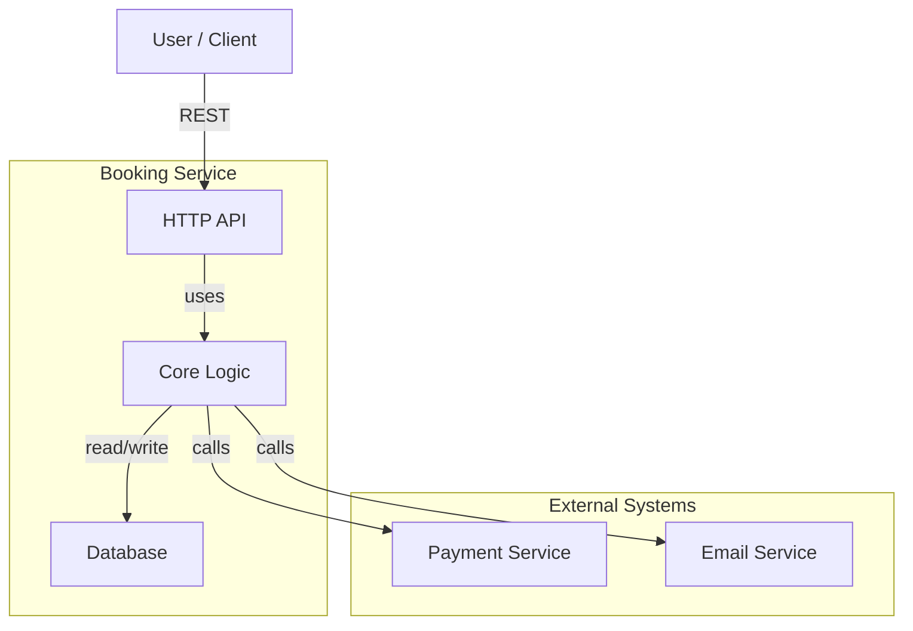

# Architecture Overview

## System Context (C4 Level 1)



## Container Architecture (C4 Level 2)

| Layer | Responsibility | Key Types |
|-------|----------------|-----------|
| **Controller** | HTTP parsing, validation, response mapping | Request, Response DTO |
| **UseCase** | Service orchestration, transaction coordination | Execute() method |
| **Service** | Business logic, domain rules, metrics | entity.*, errors.* |
| **Repository** | Data access, query translation | DTO→Entity mappers |
| **Domain** | Core types, no external dependencies | entity.*, enum.*, errors.* |

## Dependencies

```
controller/ ──→ usecase/ ──→ service/ ──→ repository/ ──→ domain/
                                ↓
                            repository/
```

**Rule:** Never import backwards or sideways. Interfaces declared in consuming layer.

## Directory Structure

```
cmd/
├── bookingd/           → Main binary, DI setup only
└── migrations/         → Database migrations
internal/
├── controller/         → HTTP handlers
├── usecase/            → Orchestration layer
├── service/            → Business logic
├── repository/         → Data access
└── domain/
    ├── entity/         → Core domain structs
    ├── dto/            → Transfer objects
    ├── enum/           → Enums (iota)
    ├── errors/         → Custom error types
    └── constants/      → Domain constants
pkg/
├── logger/             → Structured logging
├── errors/             → Error utilities
└── clock/              → Time abstraction
tests/
├── integration/        → Database + service tests
└── e2e/                → Full request cycle tests
docs/
├── go-rules.md         → Coding standards
├── architecture/       → C4 diagrams & ADRs
└── specs/              → API specs
```

## Next Steps

1. Create ADR files under `docs/architecture/adr/` for architectural decisions
2. Add OpenAPI spec under `docs/specs/` for each HTTP API
3. Document README.md for each package explaining purpose and public API
